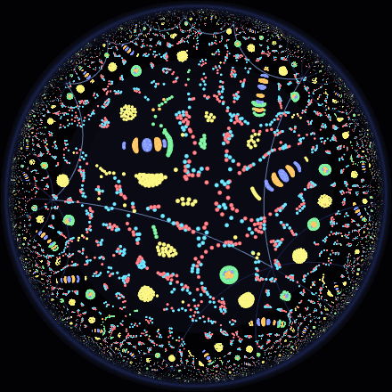
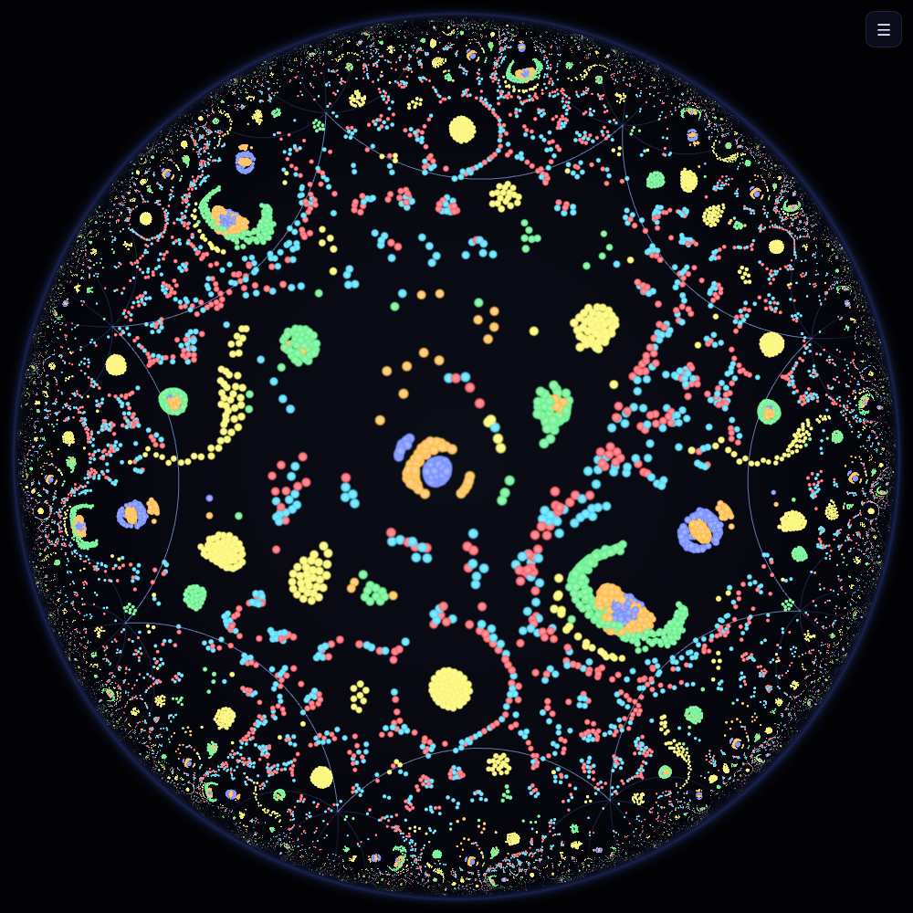
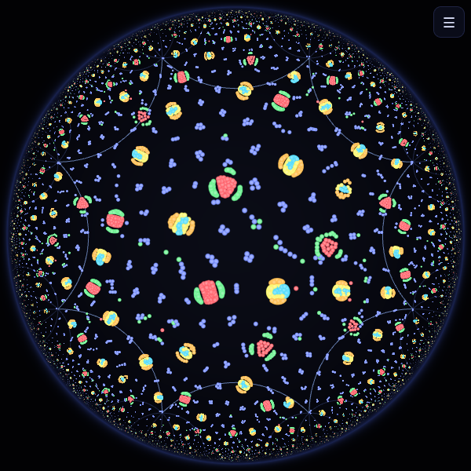
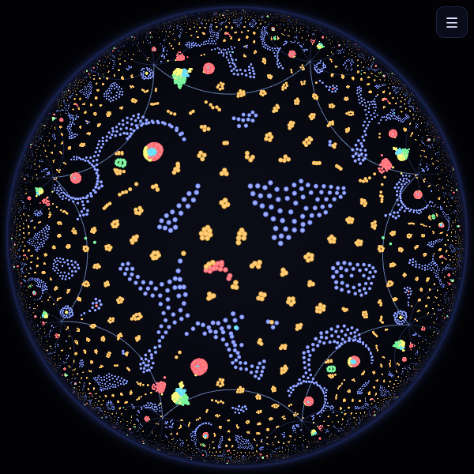
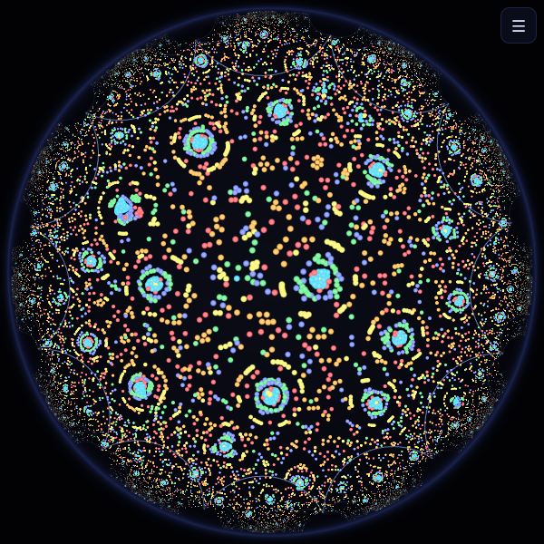
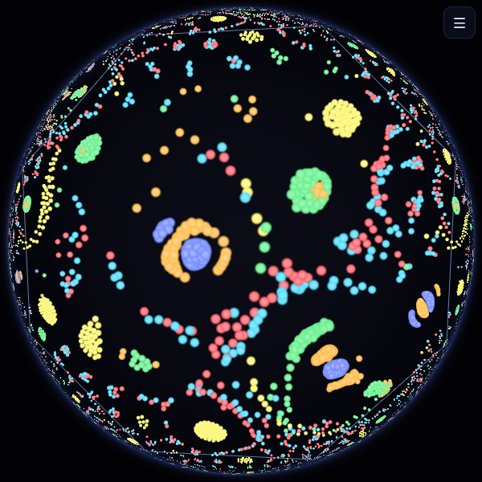

<div align="center">

# Hyperbolic Particle Life

**Artificial life on a closed surface of curved space.**

Thousands of particles, one simple rule, and a universe shaped like a two-holed donut made of hyperbolic space. Runs live in your browser.

[**▶ Open the live demo**](https://pythonretarde.github.io/hyperbolic-particle-life/) · [How it works](docs/MATH.md) · [Contributing](CONTRIBUTING.md)

[](https://github.com/PYTHONRETARDE/hyperbolic-particle-life/actions/workflows/ci.yml)


[](LICENSE)



</div>

---

## What am I looking at?

[Particle Life](https://github.com/hunar4321/particle-life) is a famous toy universe. Coloured particles attract or repel each other according to a small table of numbers ("red likes green, green fears blue…"), and lifelike creatures emerge: cells, worms, hunters, membranes.

Every Particle Life implementation we know of runs on a flat screen that wraps around at the edges, which makes the world a **flat torus**. This one runs on a **closed hyperbolic surface**:

- Space has **constant negative curvature**. Triangles have less than 180°, circles have exponentially more room at their edge, and parallel lines spread apart.
- The world is the **Bolza surface**: a regular octagon whose opposite edges are glued together. Because its corners are 45°, eight octagons fit around every point. The result is a closed universe with **two holes** (genus 2) and no edge anywhere.
- You see the surface **from the inside**. The central octagon is the *whole* universe. Every other octagon is the same universe again, seen along a different path around the holes, so each creature appears infinitely many times, shrinking toward the rim of the [Poincaré disk](https://en.wikipedia.org/wiki/Poincar%C3%A9_disk_model).

Look at the corners of the central octagon in the screenshot below: the same creature sits on all eight. On the surface, all eight corners are glued into **one point**.

<p align="center"></p>

As far as we can tell, nobody has put Particle Life on a closed hyperbolic surface before. We looked and couldn't find one. If you know of prior work, please open an issue so we can credit it.

## Gallery

| Membranes (seed 2) | Networks (seed 3) | Genus 3 (12-gon) | Klein model |
|---|---|---|---|
|  |  |  |  |

Every universe is reproducible: the URL stores the surface, the physics and the rule matrix, so **Copy link** shares exactly what you are looking at.

## Controls

| | |
|---|---|
| **Drag** | fly through space (with inertia) |
| **Shift + drag** / right-drag | push particles away |
| **Ctrl + drag** | pull particles in |
| **Double-click** | glide that point to the centre |
| **Wheel / pinch** | zoom the disk |
| **Arrows / WASD**, **Q / E** | fly, rotate |
| **Space** | pause |
| **N** / **R** | new universe / scatter particles |
| **T C K G P** | tiling · copies · Klein model · glow · auto-tour |
| **H** / **F** / **?** | panel · fullscreen · intro |

The **Rules** grid is live-editable: drag a cell up or down to change how the row colour feels about the column colour. Turn up **Evolution** to make the rules drift by themselves and watch creatures morph into new ones.

## Run it locally

No build step and no runtime dependencies: just ES modules and WebGL2.

```bash
git clone https://github.com/PYTHONRETARDE/hyperbolic-particle-life.git
cd hyperbolic-particle-life
npm start          # zero-dependency static server → http://localhost:8080
npm test           # 30+ tests of the geometry, spatial index and physics
npm run bench      # headless simulation benchmark
```

(Opening `index.html` straight from disk won't work, because browsers block ES modules on `file://`.)

## How it works (short version)

| Problem | Solution | Where |
|---|---|---|
| Representing curved space without singularities | **Hyperboloid model**: points satisfy −t² + x² + y² = −1, isometries are 3×3 Lorentz matrices | [`hyperbolic.js`](src/hyperbolic.js) |
| Moving a particle "in a straight line" | **Exponential map** along geodesics, velocity carried by **parallel transport** | [`sim.js`](src/sim.js) |
| Building a closed surface | Regular 4g-gon, opposite sides glued by hyperbolic translations of length 2·arccosh(cot(π/4g)) | [`surface.js`](src/surface.js) |
| Forces across glued edges | **Ghost particles**: copies pushed through the gluing maps into the 48 neighbouring octagons | [`sim.js`](src/sim.js) |
| Finding neighbours fast when a uniform grid is useless | **Binary tiling of the upper half-plane**, where every cell has the same hyperbolic size and queries are exact | [`spatial.js`](src/spatial.js) |
| Drawing infinitely many copies | One WebGL draw call per visible tile, each with its own Lorentz matrix. Far tiles draw a random subset | [`render.js`](src/render.js) |
| Flying forever without numbers blowing up | Camera matrix is re-reduced into the fundamental domain after every move | [`camera.js`](src/camera.js) |

The full derivations, with formulas, are in **[docs/MATH.md](docs/MATH.md)**.

## Hack on it from the console

The running app is exposed as `window.hpl`:

```js
hpl.sim.params.force = 25                 // stronger forces
hpl.sim.setMatrix(hpl.PRESETS.hunt(6))    // predator–prey ring
hpl.setGenus(3)                           // move to a genus-3 surface
hpl.camera.glide(0, 1.5)                  // fly 1.5 units
hpl.H.dist(hpl.camera.position(), hpl.H.ORIGIN)
```

## Project layout

```
index.html, style.css     the page and panel
src/hyperbolic.js         hyperboloid-model geometry (pure, tested)
src/surface.js            genus-g surfaces, gluing maps, tilings
src/spatial.js            hyperbolic spatial index
src/sim.js                Particle Life on the surface
src/render.js             WebGL2 renderer
src/camera.js             camera that can fly forever
src/main.js               UI, input, main loop
src/rules.js, state.js    rule presets, PRNG, shareable URLs
test/                     node:test suites (no dependencies)
scripts/                  dev server, benchmark, screenshot/GIF recorder
```

## Contributing

Ideas, bug reports and pull requests are very welcome. See **[CONTRIBUTING.md](CONTRIBUTING.md)** and the issues labelled [`good first issue`](https://github.com/PYTHONRETARDE/hyperbolic-particle-life/labels/good%20first%20issue). Some directions we would love help with:

- **GPU physics.** Move the force loop into a WebGL2/WebGPU compute pass to reach 50k+ particles.
- **Flat torus mode.** Run the same rules side by side on a flat torus, to see what curvature changes.
- **3D view.** Draw a (non-isometric) double-torus with the particles mapped onto it.
- **More surfaces.** Other gluings, non-regular polygons, non-orientable surfaces.
- **Sound.** Turn creature activity into audio.

## Credits

- Particle Life as popularised by Jeffrey Ventrella's *Clusters* and Tom Mohr's Particle Life app, and [hunar4321/particle-life](https://github.com/hunar4321/particle-life). The force kernel here follows the same widely used form.
- The Bolza surface is named after Oskar Bolza (1887).

MIT licensed.
